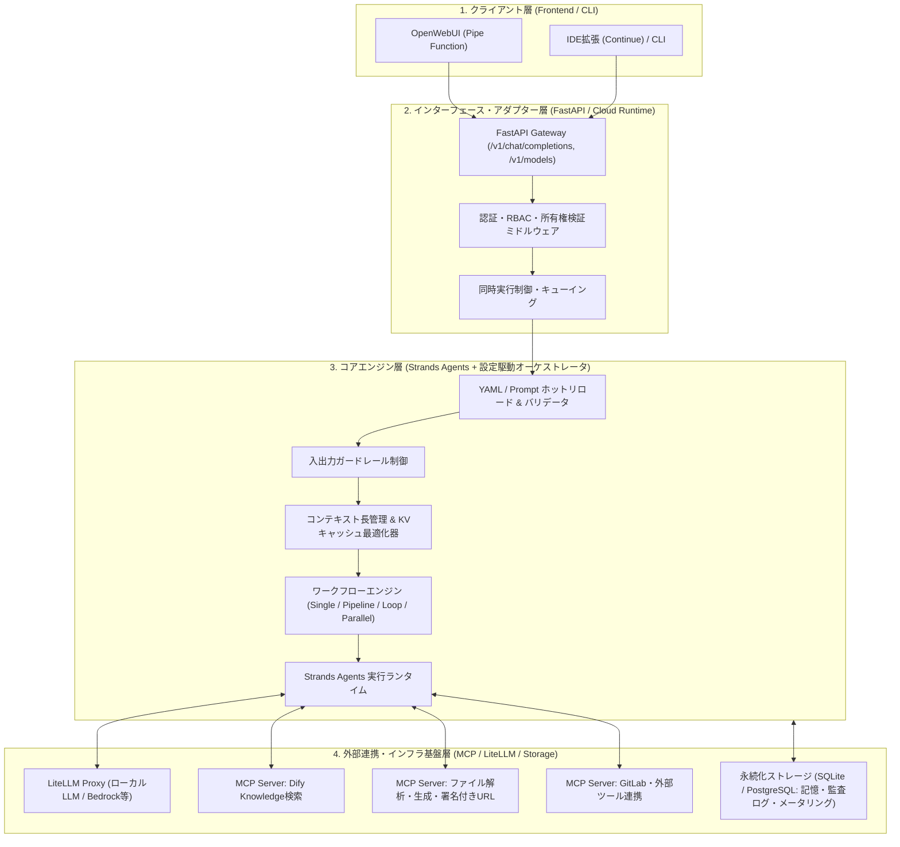
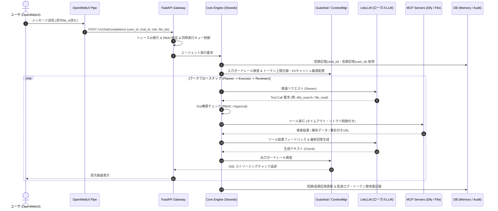

# AI Agent Platform 基本設計書

## 1. 本書の目的と位置づけ

本書は、「要件定義書（FR-001〜FR-018、NFR-001〜NFR-005）」に基づき、閉塞ネットワーク（NW）環境で稼働し、かつ将来的なパブリッククラウド（AWS Bedrock AgentCore 等）への移植性を備えた **汎用AIエージェントプラットフォーム** の基本設計を定義する。

本設計書は、開発者およびコーディングエージェント（OpenCode / Claude Code 等）が実装を行う際のアーキテクチャ基準・スキーマ定義として機能する。

---

## 2. システム全体アーキテクチャ

### 2.1 レイヤード・ヘキサゴナル構造（コアとインフラの分離）

NFR-005（マルチクラウド移植性・過剰実装の分離）を満たすため、システム全体を以下の **4層構造** に分離する。



### 2.2 設計の基本方針

* **完全オフライン前提（NFR-002）**：すべての Python ライブラリ、トークナイザー辞書、フォント（日本語ドキュメント生成用）は Docker ビルド時に組み込み、起動後の外部通信（テレメトリ含む）を完全に遮断する。
* **インフラ依存の抽象化（NFR-005）**：`MemoryStore`、`AuditLogger`、`FileStorage`、`RateLimiter` は抽象基底クラス（Interface）として定義し、閉塞NW用（ローカルDB/FastAPIミドルウェア）とクラウド用（AgentCore Memory等）をアダプター差し替えで切り替え可能とする。

---

## 3. ディレクトリ構成設計

開発者が管理するコアプログラム（`core/`）と、非エンジニア（設計者・テスター・PJ管理者等）が編集する業務エージェント定義（`agents/`）を厳格に分離する（NFR-004）。

```text
ai-agent-platform/
├── docs/                          # 設計ドキュメント（要件定義書・本基本設計書）
├── docker/                        # 閉塞NW持ち込み用 Dockerfile・オフラインビルド資材
├── core/                          # 【基盤領域】プラットフォームコア（現場は編集しない）
│   ├── main.py                    # FastAPI エントリポイント
│   ├── config/
│   │   ├── system_config.yaml     # システム全体設定（タイムアウト、同時実行数、TTL等）
│   │   └── rbac_roles.yaml        # ロール定義とエージェント・ツール権限制御マトリクス
│   ├── api/                       # OpenAI互換エンドポイント (/v1/chat/completions, /v1/models)
│   ├── middleware/                # 認証・RBAC・所有権チェック・レート制限・トレースID付与
│   ├── engine/                    # コア実行エンジン
│   │   ├── agent_loader.py        # YAML/Markdown ホットリロード & Pydantic バリデータ
│   │   ├── workflow_runner.py     # Single / Sequential / Loop / Parallel オーケストレータ
│   │   ├── strands_factory.py     # Strands Agent インスタンス動的生成・フック注入
│   │   ├── context_manager.py     # トークン見積もり・スライディングウィンドウ・要約圧縮・KVキャッシュ配置
│   │   └── guardrail.py           # 入力・出力ガードレール（PIIマスク・インジェクション検知）
│   ├── adapters/                  # 【移植性分離層】インフラ抽象インターフェースと実装
│   │   ├── base.py                # Memory / Audit / Metering / File 抽象インターフェース
│   │   ├── local_db.py            # 閉塞NW用実装（SQLite / PostgreSQL）
│   │   └── cloud_stub.py          # 将来の AWS Bedrock AgentCore 等への移植用アダプター枠
│   ├── mcp_client/                # MCP サーバー接続プール・リトライ・タイムアウト・権限フィルタ
│   └── utils/                     # 構造化JSONロガー・トークン集計・Mermaid-to-YAML変換パーサー
│
├── agents/                        # 【現場領域】ローコード／ノーコード編集エリア（ホットリロード対象）
│   ├── _template/                 # 新規作成用テンプレート
│   │   ├── config.yaml
│   │   ├── system_prompt.md
│   │   └── workflow.mmd
│   ├── agent_builder/             # FR-018: エージェント作成支援ウィザード（標準搭載）
│   │   ├── config.yaml
│   │   ├── system_prompt.md
│   │   └── workflow.mmd
│   ├── knowledge_qa/              # ユースケース例1: 社内ナレッジ検索・QA対応
│   └── code_reviewer/             # ユースケース例2: 設計書・コード生成＆自律レビュー
│
└── integrations/                  # フロントエンド連携用プラグイン
    └── openwebui_pipe.py          # OpenWebUI Pipe Function（user_id, chat_id, file_id, role 連携）
```

---

## 4. 機能詳細設計

### 4.1 OpenWebUI 連携・API インターフェース設計（FR-001, FR-015）

OpenWebUI からのリクエスト（Pipe Function 経由）および Continue / CLI からのリクエストを統一的に扱うため、OpenAI 互換の REST API を提供する。

* **エンドポイント**：
  * `GET /v1/models`：リクエスト元の `role`（RBAC）に基づき、利用許可された `agents/` 配下のエージェント一覧をモデルとして返却する。
  * `POST /v1/chat/completions`：ストリーミング（SSE）および非ストリーミング応答に対応。
* **メタデータ引き渡し仕様**：
  * OpenWebUI の `openwebui_pipe.py` または外部クライアントの HTTP ヘッダ／`metadata` フィールドから以下を受領する。
    * `X-User-Id` / `metadata.user_id`（必須：所有者境界および長期記憶キー）
    * `X-Chat-Id` / `metadata.chat_id`（必須：短期記憶およびトレースキー）
    * `X-User-Role` / `metadata.role`（未指定時はデフォルト `Guest` を適用）
    * `metadata.file_ids`（アップロード済みファイルの識別子リスト）

### 4.2 エージェント設定ファイル（`config.yaml`）スキーマ設計（FR-002, FR-008, FR-009, FR-016）

非エンジニアが直感的に編集でき、かつウィザード（FR-018）から自動生成可能な YAML スキーマを定義する。

```yaml
# agents/<agent_id>/config.yaml スキーマ仕様
agent:
  id: "agent-codereview"                     # OpenWebUI上のモデルID
  name: "設計書・コード生成＆自律レビュー"     # 表示名
  description: "設計書からコードを生成し、規約に基づき自己レビューを行います"
  enabled: true                              # 有効・無効フラグ

access_control:                              # FR-011: RBAC
  allowed_roles: ["Admin", "PowerUser", "User"]

models:                                      # FR-002: LiteLLM登録モデル名（ロール別使い分け）
  default: "local-gpt-oss-120b"
  planner: "local-gpt-oss-120b"
  executor: "local-qwen-coder-32b"
  reviewer: "local-gpt-oss-120b"

workflow:                                    # FR-008: ワークフロー制御
  type: "loop"                               # single | sequential | loop | parallel
  max_iterations: 2                          # loop時の最大差し戻し回数
  steps:
    - id: "plan"
      role: "planner"
      prompt_file: "prompts/planner.md"
      tools: ["dify_search", "gitlab_read"]
    - id: "execute"
      role: "executor"
      prompt_file: "prompts/executor.md"
      tools: ["file_read", "file_write", "doc_generate"]
    - id: "review"
      role: "reviewer"
      prompt_file: "prompts/reviewer.md"
      tools: ["dify_search"]
      condition:
        on_reject_goto: "execute"            # NG判定時の差し戻し先ステップID

tools:                                       # FR-004, FR-005, FR-006, FR-012
  mcp_servers:
    - name: "dify-mcp"
      allowed_tools: ["dify_search"]
      config:
        dataset_ids: ["ds-design-001", "ds-guideline-002"]
        search_method: "hybrid"              # keyword | semantic | hybrid
    - name: "file-mcp"
      allowed_tools: ["file_read", "doc_generate"]
  require_approval_tools: ["gitlab_merge"]   # Human-in-the-Loop 確認対象ツール

memory:                                      # FR-010: Memory管理
  short_term:
    enabled: true
    strategy: "summarize_and_window"         # window | summarize | summarize_and_window
    max_turns: 10
  long_term:
    enabled: true
    auto_extract: true                       # 会話からユーザ属性・前提条件を自動抽出

guardrails:                                  # FR-016: ガードレール制御
  input_policies: ["prompt_injection_check", "pii_mask"]
  output_policies: ["secret_leak_check"]
  on_violation: "block"                      # block | mask
```

* **ホットリロードとバリデーション（FR-009, NFR-004）**：
  * `agent_loader.py` はファイルの更新タイムスタンプ（`mtime`）を監視し、変更検知時に即時リロードする。
  * Pydantic によるスキーマ検証に失敗した場合、プロセスは停止させず、当該エージェント呼び出し時に **日本語のエラー詳細（ファイル名・該当キー・修正例）** をチャット応答として返却する。

### 4.3 コンテキスト管理と KV キャッシュ最適化設計（NFR-001）

ローカル LLM（vLLM / Ollama）の推論速度向上（TTFT 短縮）とコンテキスト長超過エラー防止のため、LLM 送信直前にプロンプト構造を以下の順序で組み立てる。

```text
[1. 静的システムプロンプト（system_prompt.md + ツール定義スキーマ）]  <-- 完全固定（KVキャッシュ最優先ヒット領域）
[2. 長期記憶サマリ（user_id 単位の永続コンテキスト）]                <-- セッション中は固定
[3. 圧縮済み過去履歴 / スライディングウィンドウ履歴（chat_id 単位）]   <-- しきい値到達時のみ再要約
[4. 動的コンテキスト（現在時刻、検索結果、添付ファイル抽出テキスト、最新質問）] <-- 毎回変化するため末尾配置
```

* **トークン上限制御**：モデルの最大コンテキスト長の **80%（設定変更可）** を上限とし、超過時は「添付ファイルの関連チャンク抽出 → 古い履歴の要約圧縮 → スライディングウィンドウ切り詰め」の順で自動調整し、それでも超過する場合は LLM へ送信せずエラー案内を返す。

### 4.4 MCP サーバー連携・ファイル入出力設計（FR-004〜FR-007, FR-012）

既存および新規の MCP サーバー（Streamable HTTP / SSE）とは `mcp_client` モジュール経由で通信する。

1. **ツール実行前フック（Strands Hooks）**：
   * ツール呼び出し直前に `RBACロール権限`、`エージェント許可リスト`、`対象パス／ホスト制限（NFR-003）` を検証し、不正呼び出しを遮断する。
   * `require_approval_tools` に該当するツールは、実行内容の確認メッセージをユーザへ返却し、次ターンで承認が得られた場合のみ実行する。
2. **ファイル受け渡しフロー（FR-005〜FR-007）**：
   * アップロードファイルは `file_id` をキーに `file-mcp` 上で解析（PDF/Office/画像OCR等）し、必要箇所のみコンテキストへ展開する。
   * 生成ファイル（Word/Excel/PPT/PDF）は `file-mcp` が生成後、**有効期限（TTL）付きの署名付きダウンロードURL** を発行し、エージェントが Markdown リンクとしてユーザへ提示する。

### 4.5 エージェント作成支援ウィザード設計（FR-018）

非エンジニア向けのノーコード作成機能は、コア改修ではなく標準搭載エージェント `agents/agent_builder` として実装する。

1. **対話ヒアリング**：業務目的・入力ファイル有無・利用ツール（Dify検索／GitLab／文書出力）を選択肢付きで対話収集する。
2. **Mermaid 視覚化**：収集結果からシンプルな `flowchart TD` を生成し、OpenWebUI の標準レンダリング機能でフローチャート図を提示する。
3. **自動変換・出力**：ユーザ承認後、`Mermaid-to-YAML` パーサーまたは構造化出力により、`config.yaml`・`system_prompt.md`・`workflow.mmd` の 3 ファイルを生成する（権限を持つ場合は MCP 経由で `agents/` へ下書き保存、一般ユーザはダウンロードリンク発行）。

---

## 5. データモデル・永続化設計（FR-010, FR-013, FR-014, FR-017, NFR-004）

すべてのテーブルに `user_id`（所有者）を持たせ、データアクセス層で `WHERE user_id = :request_user_id` を強制する（FR-013）。

| テーブル名 | 主なカラム | 用途・保持ポリシー（TTL） |
| :--- | :--- | :--- |
| `short_term_memories` | `id`, `user_id`, `chat_id`, `role`, `content`, `summary_flag`, `created_at` | セッション単位の短期記憶。設定された TTL（例：30日）経過後にバッチで自動削除。 |
| `long_term_memories` | `id`, `user_id`, `category`, `fact_text`, `updated_at` | ユーザ単位の長期記憶。永続化および定期バックアップ対象。 |
| `audit_logs` | `trace_id`, `timestamp`, `user_id`, `chat_id`, `user_role`, `agent_id`, `workflow_type`, `model_name`, `tool_calls_json`, `status`, `error_detail`, `latency_ms` | 監査ログおよび障害トレース用証跡（FR-014）。追記専用（Append-Only）で永続化。 |
| `token_metering` | `id`, `trace_id`, `timestamp`, `user_id`, `agent_id`, `model_name`, `prompt_tokens`, `completion_tokens`, `cached_tokens` | トークン使用量計測・集計用（FR-017）。クォータ判定にも利用。 |

## 6. 処理シーケンス（代表フロー：ワークフロー実行＋ツール利用）



---

## 7. 非機能要件への対応マトリクス

| 要件ID | 項目 | 基本設計における実現方式 |
| :--- | :--- | :--- |
| **NFR-001** | **性能要件** | FastAPI の `StreamingResponse` による SSE 逐次応答。システムプロンプト先頭固定による vLLM/Ollama KV キャッシュ最適化。`asyncio.Semaphore` による同時実行キュー制御。 |
| **NFR-002** | **可用性・信頼性** | Docker ビルド時のオフライン完結（事前キャッシュ・テレメトリ環境変数 OFF）。`tenacity` 等による MCP ツール呼び出し指数バックオフリトライ。Strands による LLM ツール引数 JSON 構文エラーの自動自己修正ループ。 |
| **NFR-003** | **セキュリティ** | `user_id` フィルタの強制によるデータ分離。MCP サーバー側での署名付き URL（HMAC トークン＋有効期限）発行。高権限ツールのホワイトリスト制限および実行前確認フロー。シークレットの環境変数注入。 |
| **NFR-004** | **運用性・保守性** | `agents/` ディレクトリのホットリロード＆Pydantic バリデーション日本語エラー通知。全レイヤー共通の `trace_id` 付き JSON 構造化ログ。TTL ベースの定期クリーンアップジョブ。 |
| **NFR-005** | **拡張性・移植性** | `core/adapters/` によるインフラ依存分離。将来 AWS Bedrock AgentCore 等へ移行する際は、`core/engine/` と `agents/`（YAML・プロンプト）および MCP サーバー群をそのまま流用し、アダプター層のみ差し替える。 |

---

## 8. 段階的実装ロードマップ（検証〜閉塞NW本番展開）

OpenCode / Claude Code を用いた実装は、以下のフェーズ順に段階的に進める。

1. **Phase 1：最小コア＆MCP疎通プロトタイプ（自宅 Bedrock 検証環境）**
   * `core/main.py`、`agent_loader.py`、`strands_factory.py`、LiteLLM 接続、既存 MCP サーバー（`http://localhost:8000/mcp`）連携の実装と疎通確認。
2. **Phase 2：ワークフロー・記憶管理・ファイル連携の実装**
   * `workflow_runner.py`（Sequential / Loop）、短期・長期記憶（SQLite）、コンテキスト圧縮・KV キャッシュ最適化、OpenWebUI Pipe Function の実装。
3. **Phase 3：セキュリティ・可観測性・ウィザードの実装**
   * RBAC・Tool 権限制御、ガードレール、監査ログ・トークン計測、および `agents/agent_builder`（FR-018）の実装。
4. **Phase 4：閉塞NW向けオフラインパッケージング**
   * オフラインビルド用 Dockerfile・事前キャッシュスクリプト・運用テンプレートの整備および閉塞環境デプロイ試験。
